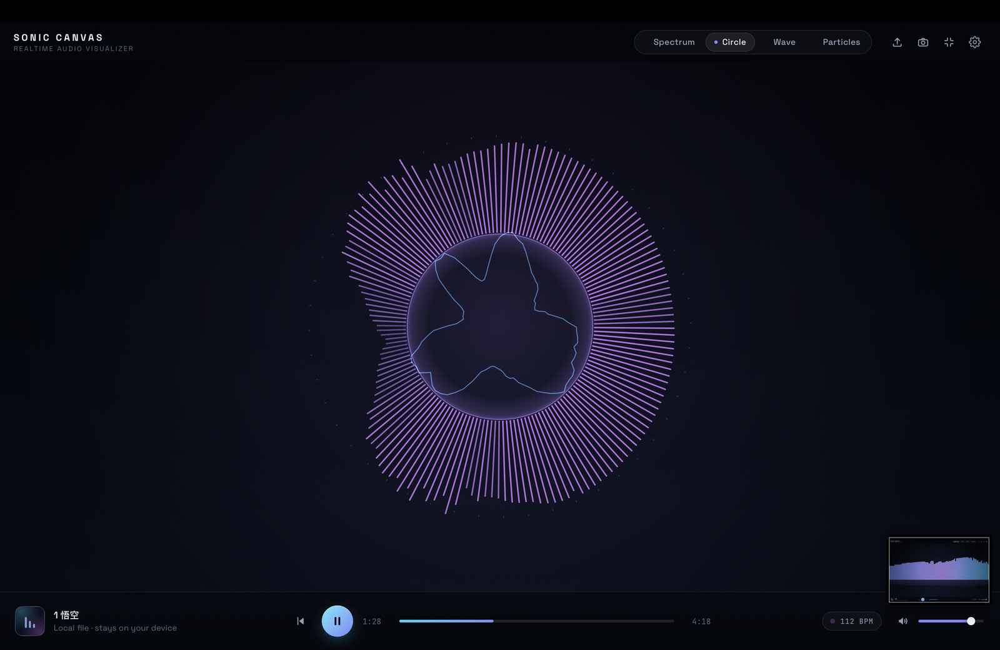
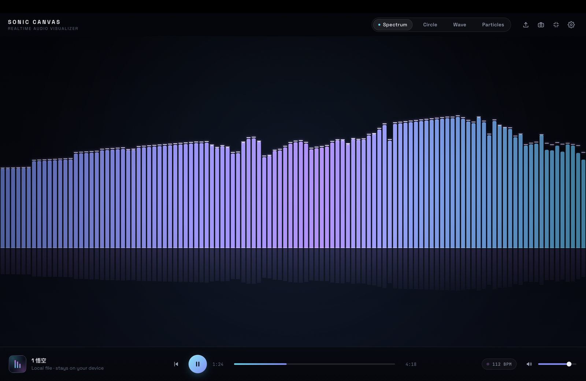
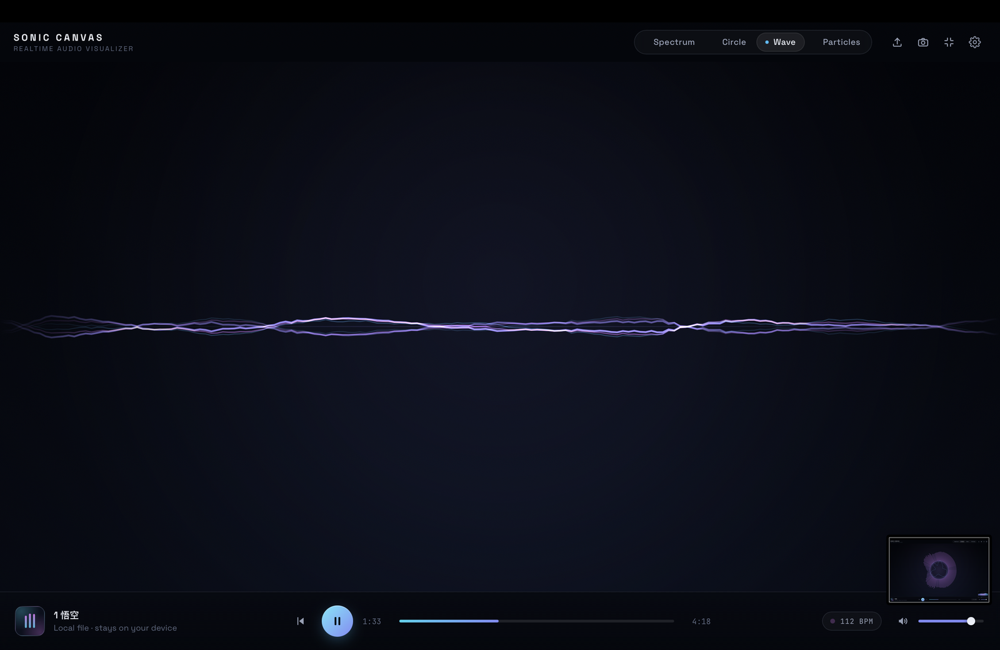
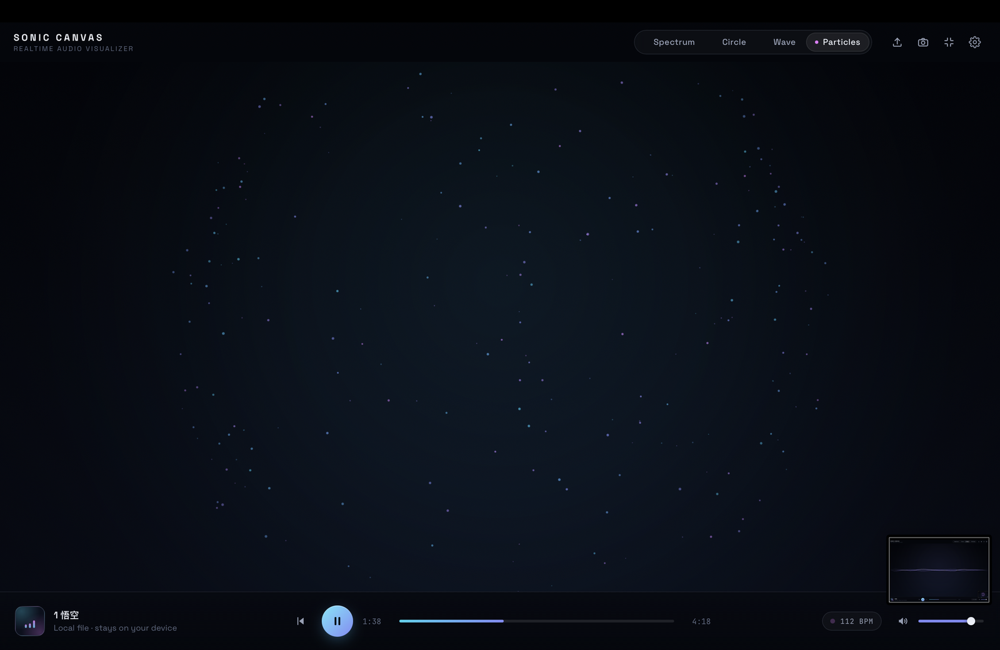

# Sonic Canvas

一个运行在浏览器里的本地音乐可视化器。把音乐文件拖进网页，它会把音频实时分解成低频 / 中频 / 高频能量与节拍，驱动四种可切换的可视化动画。

**所有音频都只在你的浏览器本地处理，不会上传到任何服务器。**

🔗 **在线试玩**：<https://Serendipity431.github.io/sonic-canvas/>



## 运行

零依赖，不需要 npm install。在项目目录执行：

```bash
python3 server.py
```

浏览器会自动打开 `http://127.0.0.1:5173`。（本质是纯静态页面，任何静态服务器都可以，但不要直接双击 index.html —— `file://` 协议无法加载 ES Module，页面会提示你改用本地服务器。）

## 导入音乐

- 点击 **Choose Music** 选择文件，或把音频文件**拖到页面任意位置**；
- 支持 MP3 / WAV / M4A / FLAC / OGG 等浏览器能解码的格式；
- 没有音乐文件时点 **Try Demo**，会生成一段程序模拟的电子乐（无声）驱动全部可视化效果。

## 四种模式

| 模式 | 效果 | 快捷键 |
| --- | --- | --- |
| Spectrum | 对数频谱柱 + 倒影 + 峰值帽，鼓点时基线闪光 | `1` |
| Circle | 中心圆随低频呼吸，环形频谱 + 波形环，节拍时扩散光环 | `2` |
| Wave | 多层镜像实时波形，边缘渐隐，能量越大振幅越大 | `3` |
| Particles | 能量驱动粒子场，鼓点时从中心向外爆发 | `4` |

其他快捷键：`Space` 播放/暂停 · `R` 从头播放 · `F` 全屏 · `M` 静音。

| Spectrum | Circle |
| --- | --- |
|  |  |
| **Wave** | **Particles** |
|  |  |

## 设置

右上角齿轮打开设置面板，全部实时生效，可一键恢复默认：

- **Sensitivity**：整体响应灵敏度
- **Smoothing**：动画平滑度（映射到 AnalyserNode 与各模式）
- **Particles**：粒子数量（默认 240，上限 480）
- **Visual intensity**：视觉强度
- **Show FPS**：帧率显示

## 发布到 GitHub

仓库里带了一个一键发布脚本（建仓库、推送、写简介和话题标签、开启 GitHub Pages 在线试玩）：

```bash
gh auth login            # 只需一次：选 GitHub.com → HTTPS → Yes → Login with a web browser
bash scripts/publish.sh  # 之后每次更新，重跑这一条即可
```

不想用脚本的话，手动等价操作：在 github.com 新建空仓库后，`git init` → `git add -A` → `git commit` → `git remote add origin …` → `git push -u origin main`，再到 Settings → Pages 选 main 分支。

## 生成测试音频（可选）

```bash
python3 scripts/make_test_audio.py   # 生成 test-assets/test-beat.wav（24s / 120 BPM）
```

## 主要技术

- HTML5 + CSS + 原生 JavaScript（ES Modules），无框架、无构建步骤
- Web Audio API：`AudioContext` + `AnalyserNode`（FFT 2048），按实际采样率把 bin 换算为 20–250 / 250–2000 / 2000+ Hz 三段能量
- Canvas 2D，`requestAnimationFrame` 单主循环，DPR 自适应（Retina 上限 2x）
- 节拍检测：当前低频能量 vs 近 1 秒移动平均，带阈值 / 上升沿 / 260ms 冷却，并据此估算 BPM
- 粒子系统对象池预分配，稳态零逐帧分配；渐变与颜色字符串按档位缓存

## 项目结构

```
sonic-canvas/
├── index.html                  # 页面结构 + 图标
├── server.py                   # 一键本地服务器（Python 标准库）
├── favicon.svg
├── LICENSE                     # MIT
├── src/
│   ├── main.js                 # 入口
│   ├── core/
│   │   ├── App.js              # 总控：状态、UI 接线、主渲染管线
│   │   ├── Renderer.js         # Canvas/DPR/resize/背景层/FPS
│   │   ├── Settings.js         # 设置存储（localStorage 持久化）
│   │   └── palette.js          # 三色渐变色板与取色工具
│   ├── audio/
│   │   ├── AudioEngine.js      # 播放 + 频谱/波形/三段能量分析
│   │   ├── BeatDetector.js     # 节拍检测 + BPM 估算
│   │   └── DemoDriver.js       # 程序生成的模拟音源（Demo 模式）
│   ├── visualizers/
│   │   ├── SpectrumVisualizer.js
│   │   ├── CircleVisualizer.js
│   │   ├── WaveVisualizer.js
│   │   ├── ParticleVisualizer.js
│   │   └── spectrumMap.js      # FFT bin → 显示柱的对数映射
│   ├── ui/
│   │   ├── PlayerControls.js   # 自绘播放器控制栏
│   │   ├── SettingsPanel.js
│   │   ├── Toast.js
│   │   └── Shortcuts.js
│   └── styles/main.css
└── scripts/
    ├── publish.sh              # 一键发布到 GitHub + Pages
    └── make_test_audio.py      # 生成测试音频（可选）
```

## 已知说明

- Demo 模式是"可视化演示"，故意不发声；想听声音请导入真实音乐文件。
- 音量调低不会削弱动画——分析器接在音量节点之前，画面始终跟随音乐本身。
- 页面失焦时浏览器会暂停 requestAnimationFrame，回到前台即恢复，属正常浏览器行为。
